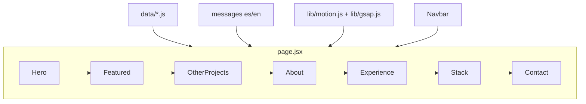

# Design system — Mia Passalia portfolio

## Mode

**Experience** (portfolio) with Persuade CTAs.

Visitor success in ~10 seconds: understand who she is (Full Stack Developer), see proof (featured cases), and act (projects / Pulso / contact).

## Visual world

Dark **0400AM** theme (shadcnthemer; palette only, no shadcn/ui).

- Night purple-slate surfaces (`oklch` ~298° hue)
- Primary lilac `oklch(0.686 0.143 285.66)`
- Secondary green `oklch(0.642 0.105 158.02)` (available badge, focus/ring)
- Accent deep violet `oklch(0.437 0.106 285.26)`
- Radius `0.625rem`
- Atmosphere via soft primary glow on the hero mockup only

## Typography

- Display: **Fraunces** (`--font-display`)
- Body: **Plus Jakarta Sans** (`--font-body`)
- Mono: **JetBrains Mono** (`--font-mono`)

## Identity

- Primary role site-wide: **Full Stack Developer** / **Desarrolladora full stack** (strong frontend focus; backend Node / Express). NestJS only in Pulso stack.
- Name and contact live in `data/profile.js` + i18n; no hardcoded UI copy in components.

## Information architecture

Page order (`app/[locale]/page.jsx`):

1. Hero — `#welcome`
2. Featured case studies — `#featured`
3. Other projects (bento) — `#projects`
4. About — `#about`
5. Experience timeline — `#experience`
6. Stack marquee — `#stack`
7. Contact — `#contact`

Navbar anchors mirror these ids (plus language switcher and socials). Scroll progress bar sits under the sticky nav.

## Component map

| Section | `id` | Component | Data | i18n |
| --- | --- | --- | --- | --- |
| Hero | `#welcome` | `components/sections/Hero.jsx` | `profile` (availability, pulso link via projects) | `welcome` |
| Featured | `#featured` | `components/sections/FeaturedProjects.jsx` | `projects` where `featured: true` | `projects` / `featured` / `projects.items.*` |
| Other | `#projects` | `components/sections/ProjectsGrid.jsx` | non-featured + `tags[]` | `projects` |
| About | `#about` | `components/sections/About.jsx` | `profile` age helper | `about` |
| Experience | `#experience` | `components/sections/ExperienceTimeline.jsx` | `experienceIds` | `experience` |
| Stack | `#stack` | `components/sections/StackMarquee.jsx` | `techs` grouped | `tech` |
| Contact | `#contact` | `components/sections/Contact.jsx` | `profile` email, socials, cv paths | `contact` |

Shared:

- `components/layout/Navbar.jsx` — sticky blur, active section, scroll progress
- `components/ui/ProjectGalleryModal.jsx` — gallery (`.t-modal`)
- `components/motion/Reveal.jsx` — scroll reveal with reduced-motion fades
- `lib/gsap.js` — `gsap`, `useGSAP`, `ScrollTrigger`, `SplitText`, `Flip`, `ScrollToPlugin`
- `lib/motion.js` — duration/distance tokens + reduced-motion helpers

## Data / i18n contracts

**Always:** structure, URLs, stacks, tags, media paths → `data/*.js`.  
**Always:** user-facing strings → `messages/{es,en}.json`.  
**Never:** hardcoded role, headlines, CTAs, or case-study copy in JSX.

### `data/profile.js`

- `name`, `email`, `github`, `linkedin`, `cv: { es, en }`, `birthDate`, `getAge()`

### `data/projects.js`

- `projects[]`: `id`, `featured?`, `tags[]`, `techs` (display string or list), `mode` (`link` | `gallery`), `href?`, `demoUrl?`, `repoUrl?`, `external?`, `media`, `gallery?`
- Featured order: Pulso → ReaperSquad accounts → Settlement (`liquidacion`)
- `techs[]` for marquee: `{ name, logo, path, group: "frontend" | "backend" | "tools" }`
- `experienceIds[]`: `{ id, href?, external? }` — copy under `experience.items.*`

### i18n namespaces

`meta`, `nav`, `welcome`, `featured`, `about`, `tech`, `experience`, `projects` (+ `items.{id}`), `contact`, `footer`.

Case-study narrative (`problem`, `whatIDid`, `decisions[3]`) lives under `projects.items.{id}`.

## Motion

transitions.dev tokens in `:root` (`--duration-*`, `--ease-*`, `--scale-*`).  
GSAP reads seconds via `lib/motion.js`. Modal uses `.t-modal` open/close recipe.

### `prefers-reduced-motion`

| Preference | Behavior |
| --- | --- |
| **no-preference** | Full timelines, SplitText word stagger, ScrollTrigger reveals/parallax, Flip filters, tilt, cursor glow, magnetic buttons, marquee |
| **reduce** | Short opacity fades only (`motion.quick` / `--duration-quick`); no parallax, tilt, glow-follow, Flip layout morph, SplitText stagger, or pulse loops |

Helpers: `prefersReducedMotion()`, `addMotionMatch(mm, { full, reduced })` in `lib/motion.js`.

transitions.dev recipes to reuse: **19 card tilt**, **06 modal**, **16 tabs sliding**, **10 success check** / text morph (copy email).

## Quality bar

- Lighthouse mobile: Performance ≥ 90, Accessibility = 100
- `next/image` for raster covers; fixed aspect ratios (no CLS)
- GSAP only via `useGSAP` with cleanup / `matchMedia.revert()`
- WCAG AA contrast; visible `:focus-visible`; keyboard-operable nav and modal
- Package manager: **pnpm** (`pnpm lint && pnpm build` per phase)
